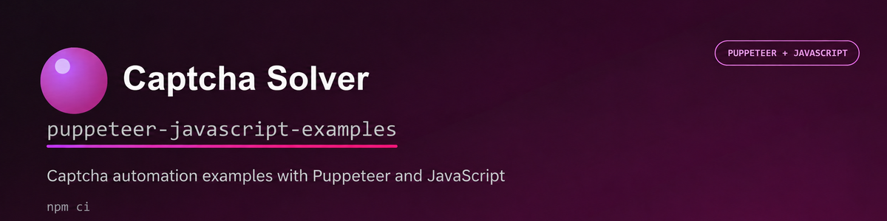

# Captcha solving examples with JavaScript and Puppeteer

Examples of solving popular captcha types with
[`@captcha-solver-api/javascript-sdk`](https://www.npmjs.com/package/@captcha-solver-api/javascript-sdk)
and [Puppeteer](https://pptr.dev/).

Each example shows how to:

1. Open a page and collect captcha parameters.
2. Send a task to Captcha Solver.
3. Apply the solution in the browser.
4. Check that the page accepted the solution.

## Installation

Requirements:

- Node.js 22.12 or newer
- A Captcha Solver API key with a positive balance

```bash
git clone https://github.com/captcha-solver-api/captcha-solver-puppeteer-javascript-examples.git
cd captcha-solver-puppeteer-javascript-examples
npm ci
```

On macOS and Linux, create the local configuration file with:

```bash
cp .env.example .env
```

On Windows PowerShell:

```powershell
Copy-Item .env.example .env
```

Set your API key in `.env`:

```dotenv
CAPTCHA_API_KEY=your_api_key
```

## Run

```bash
npm run example:recaptcha-v2
```

Chrome opens in visible mode. Set `HEADLESS=true` in `.env` to run it in the
background. Every example launches Chrome through `puppeteer-extra` with
`puppeteer-extra-plugin-stealth`, which reduces common automation fingerprints.
Stealth is not a substitute for permission to automate a website.

Each run prints numbered steps, the CAPTCHA parameters sent to the API, the
complete solution including its token, how the solution is applied, and the
demo page's acceptance message. Image bodies are shown as their base64 length;
API keys and proxy credentials are redacted.

Every example is intentionally self-contained and written as a linear tutorial:
SDK and browser setup, page navigation, parameter collection, task creation,
`solver.solve()`, solution application, form submission, and acceptance check
are all visible in the same file. Some code is repeated so that an example can
be copied without also copying hidden project helpers.

## Examples

| Captcha | File | Command |
|---|---|---|
| reCAPTCHA v2 | [`recaptcha_v2.js`](examples/reCAPTCHA/recaptcha_v2.js) | `npm run example:recaptcha-v2` |
| reCAPTCHA v2 + proxy | [`recaptcha_v2_proxy.js`](examples/reCAPTCHA/recaptcha_v2_proxy.js) | `npm run example:recaptcha-v2-proxy` |
| reCAPTCHA v2 callback | [`recaptcha_v2_callback_variant1.js`](examples/reCAPTCHA/recaptcha_v2_callback_variant1.js) | `npm run example:callback` |
| reCAPTCHA v2 callback, automatic discovery | [`recaptcha_v2_callback_variant2.js`](examples/reCAPTCHA/recaptcha_v2_callback_variant2.js) | `npm run example:callback-auto` |
| reCAPTCHA v2 callback + proxy | [`recaptcha_v2_callback_proxy.js`](examples/reCAPTCHA/recaptcha_v2_callback_proxy.js) | `npm run example:callback-proxy` |
| reCAPTCHA v3 | [`recaptcha_v3.js`](examples/reCAPTCHA/recaptcha_v3.js) | `npm run example:recaptcha-v3` |
| reCAPTCHA v3 interception | [`recaptcha_v3_extended_js_script.js`](examples/reCAPTCHA/recaptcha_v3_extended_js_script.js) | `npm run example:recaptcha-v3-extended` |
| Cloudflare Turnstile | [`cloudflare_turnstile.js`](examples/cloudflare/cloudflare_turnstile.js) | `npm run example:turnstile` |
| Cloudflare Challenge | [`cloudflare_challenge_page.js`](examples/cloudflare/cloudflare_challenge_page.js) | `npm run example:challenge` |
| Tencent CAPTCHA | [`tencent.js`](examples/tencent/tencent.js) | `npm run example:tencent` |
| Yandex SmartCaptcha | [`yandex_smartcaptcha.js`](examples/yandex/yandex_smartcaptcha.js) | `npm run example:yandex-smartcaptcha` |
| Image captcha, screenshot | [`normal_captcha_screenshot.js`](examples/normal_captcha/normal_captcha_screenshot.js) | `npm run example:image` |
| Image captcha, original pixels through canvas | [`normal_captcha_canvas.js`](examples/normal_captcha/normal_captcha_canvas.js) | `npm run example:image-canvas` |
| Image captcha with parameters | [`normal_captcha_screenshot_params.js`](examples/normal_captcha/normal_captcha_screenshot_params.js) | `npm run example:image-params` |
| Coordinates | [`coordinates.js`](examples/coordinates/coordinates.js) | `npm run example:coordinates` |

The reCAPTCHA v2 and Yandex SmartCaptcha examples use the official provider
demos by default. Every other browser example requires `TARGET_URL` in `.env`
for a page you are authorized to test.

## Proxy

```dotenv
PROXY_TYPE=http
PROXY_ADDRESS=proxy.example.com
PROXY_PORT=8080
PROXY_LOGIN=
PROXY_PASSWORD=
```

The browser and API task use the same proxy.

## Checks

```bash
npm run lint
npm run check
npm test
```

`normal_captcha_screenshot.js` sends the pixels as rendered by Chrome.
`normal_captcha_canvas.js` draws the loaded image into a canvas and sends its
original pixel data, avoiding viewport scaling and screenshot effects. Canvas
capture only works when the page permits reading the image without a CORS-tainted
canvas.

## Useful links

- [Captcha Solver API documentation](https://captcha-solver.com/en/docs/captcha-types)
- [Captcha Solver JavaScript SDK](https://github.com/captcha-solver-api/javascript-sdk)
- [Captcha Solver JavaScript Examples](https://github.com/captcha-solver-api/javascript-examples)
- [Captcha Solver Python SDK](https://github.com/captcha-solver-api/python-sdk)
- [Captcha Solver Python Examples](https://github.com/captcha-solver-api/python-examples)
- [Selenium Python Examples](https://github.com/captcha-solver-api/captcha-solver-selenium-python-examples)
- [Cloudflare Turnstile Puppeteer Demo](https://github.com/captcha-solver-api/cloudflare-turnstile-puppeteer-demo)
- [Tencent CAPTCHA Automation Guide](https://github.com/captcha-solver-api/How-to-Automate-Tencent-CAPTCHA)

## License

This project is licensed under the [MIT License](https://github.com/captcha-solver-api/tencent-captcha-puppeteer-demo/blob/main/LICENSE).
