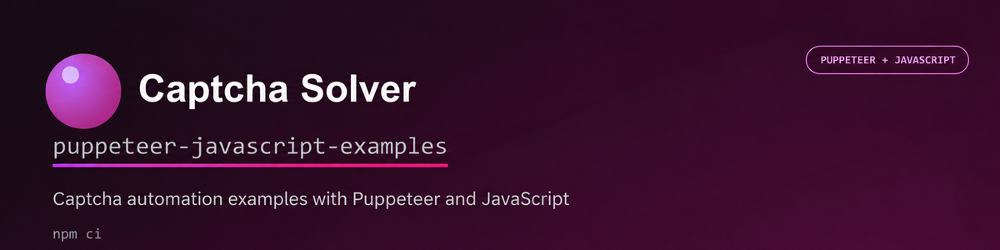

# Captcha Solver Puppeteer JavaScript Examples



Examples of solving popular captcha types with
[`@captcha-solver-api/javascript-sdk`](https://www.npmjs.com/package/@captcha-solver-api/javascript-sdk)
and [Puppeteer](https://pptr.dev/).

Use the examples only on demo pages or websites you are authorized to test.

> [!IMPORTANT]
> Live examples create paid CAPTCHA tasks. Run them only with an API key you are authorized to use
> and against a target you own or have explicit permission to test.

Each browser example shows how to:

1. Open a page and collect captcha parameters.
2. Send a task to Captcha Solver.
3. Apply the solution in the browser.
4. Check that the page accepted the solution.

## Installation

Requirements:

- Node.js 22.12 or newer
- A Captcha Solver API key with a positive balance

```bash
git clone https://github.com/captcha-solver-api/captcha-solver-puppeteer-javascript-examples.git
cd captcha-solver-puppeteer-javascript-examples
npm ci
```

On macOS and Linux, create the local configuration file with:

```bash
cp .env.example .env
```

On Windows PowerShell:

```powershell
Copy-Item .env.example .env
```

Set your API key in `.env`:

```dotenv
CAPTCHA_API_KEY=your_api_key
```

The npm example commands load this file through Node.js `--env-file-if-exists=.env`; using
`process.env` in source code does not load `.env` by itself.

## Run

```bash
npm run recaptcha-v2
npm run recaptcha-v2-enterprise
npm run recaptcha-v3
npm run turnstile
npm run turnstile-challenge
npm run yandex
npm run yandex-image
npm run tencent
npm run geetest-v3
npm run geetest-v4
npm run image-to-text
npm run coordinates
npm run balance
```

Browser examples open Chrome in visible mode. Set `HEADLESS=true` in `.env` to run them in the
background. They launch Chrome through `puppeteer-extra` with `puppeteer-extra-plugin-stealth`,
which reduces common automation fingerprints. Stealth is not a substitute for permission to
automate a website.

Browser examples log the solver result and then separately verify page acceptance. Receiving a
solution from the SDK proves only that the service completed the task; it does not prove that the
target page accepted the result. Image and balance examples print their applicable SDK result
without inventing a browser acceptance step. Image bodies are never printed, and API keys must
remain in `.env`.

Every example is intentionally self-contained and written as a linear tutorial. Browser examples
show SDK and browser setup, page navigation, parameter collection, task creation, `solver.solve()`,
solution application, form submission, and acceptance checks in one file. Image-only, coordinate,
and balance examples show their complete SDK flow without inventing browser steps. Some code is
repeated so that an example can be copied without also copying hidden project helpers.

## Examples

| Captcha                 | File                                                                    | Command                           |
| ----------------------- | ----------------------------------------------------------------------- | --------------------------------- |
| reCAPTCHA v2            | [`recaptcha-v2.js`](examples/recaptcha-v2.js)                           | `npm run recaptcha-v2`            |
| reCAPTCHA v2 Enterprise | [`recaptcha-v2-enterprise.js`](examples/recaptcha-v2-enterprise.js)     | `npm run recaptcha-v2-enterprise` |
| reCAPTCHA v3            | [`recaptcha-v3.js`](examples/recaptcha-v3.js)                           | `npm run recaptcha-v3`            |
| Cloudflare Turnstile    | [`turnstile.js`](examples/turnstile.js)                                 | `npm run turnstile`               |
| Cloudflare Challenge    | [`turnstile-challenge.js`](examples/turnstile-challenge.js)             | `npm run turnstile-challenge`     |
| Tencent CAPTCHA         | [`tencent.js`](examples/tencent.js)                                     | `npm run tencent`                 |
| Yandex SmartCaptcha     | [`yandex-smartcaptcha.js`](examples/yandex-smartcaptcha.js)             | `npm run yandex`                  |
| Yandex image challenge  | [`yandex-smartcaptcha-image.js`](examples/yandex-smartcaptcha-image.js) | `npm run yandex-image`            |
| GeeTest v3              | [`geetest-v3.js`](examples/geetest-v3.js)                               | `npm run geetest-v3`              |
| GeeTest v4              | [`geetest-v4.js`](examples/geetest-v4.js)                               | `npm run geetest-v4`              |
| Image-to-text           | [`image-to-text.js`](examples/image-to-text.js)                         | `npm run image-to-text`           |
| Coordinates             | [`coordinates.js`](examples/coordinates.js)                             | `npm run coordinates`             |
| Balance                 | [`balance.js`](examples/balance.js)                                     | `npm run balance`                 |

The reCAPTCHA v2 and Yandex SmartCaptcha examples use official provider demos by default. Other
browser examples use the matching `*_TARGET_URL` variable from `.env.example`, such as
`RECAPTCHA_V3_TARGET_URL`, `TURNSTILE_TARGET_URL`, `TURNSTILE_CHALLENGE_TARGET_URL`, and
`TENCENT_TARGET_URL`. The `example.com/page_with_...` values are placeholders, not working CAPTCHA
demos. Replace them with pages you own or are authorized to test. For Tencent, set
`TENCENT_SCRIPT_URL` if the script URL cannot be captured from the page. Changing a URL does not
automatically adapt selectors, callbacks, submission, or acceptance checks to a different page.

> [!IMPORTANT]
> CAPTCHA-solving tasks are paid API operations. Local checks use fixtures and
> do not call the paid service. Run live tests only with explicit authorization.

## Checks

```bash
npm run lint
npm run format:check
npm run check
npm test
```

`npm run check` runs linting, formatting, syntax and workflow-guide validation, and the complete
local browser regression suite. These checks use local fixtures and do not create paid tasks.

`image-to-text.js` reads a local sample image and sends its base64 contents through the SDK.

## Useful links

- [Captcha Solver API documentation](https://captcha-solver.com/en/docs/captcha-types)
- [Captcha Solver JavaScript SDK](https://github.com/captcha-solver-api/javascript-sdk)
- [Captcha Solver JavaScript Examples](https://github.com/captcha-solver-api/javascript-examples)
- [Captcha Solver Python SDK](https://github.com/captcha-solver-api/python-sdk)
- [Captcha Solver Python Examples](https://github.com/captcha-solver-api/python-examples)
- [Selenium Python Examples](https://github.com/captcha-solver-api/captcha-solver-selenium-python-examples)
- [Cloudflare Turnstile Puppeteer Demo](https://github.com/captcha-solver-api/cloudflare-turnstile-puppeteer-demo)
- [Tencent CAPTCHA Automation Guide](https://github.com/captcha-solver-api/How-to-Automate-Tencent-CAPTCHA)

## License

This project is licensed under the [MIT License](LICENSE.md).
